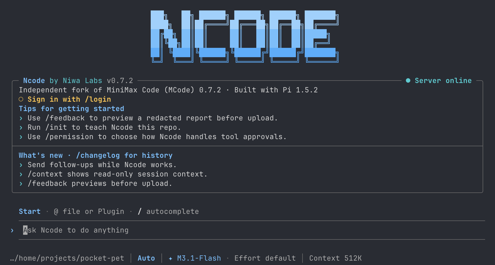

# Ncode · Niwa Labs

Ncode is a terminal coding agent from Niwa Labs, built as an independent fork of MiniMax Code (MCode) on Pi. Use MiniMax models or connect your own provider.

**English** · [简体中文](README_ZH.md)

[Get started](#quick-start) · [Documentation](docs/README.md) · [Examples](docs/examples.md) · [Changelog](packages/tui/CHANGELOG.md) · [Contributing](CONTRIBUTING.md)

  

## What Ncode adds to MCode

- **A local daemon owns your turns.** The terminal, headless runs and ACP clients share one daemon per profile. Close the terminal and the task keeps running. Reopen the workspace with the continue option to see what happened. While a subagent works, Enter steers the parent now and Alt+Enter queues your next request.
- **Daemon startup that waits.** The first start of a new build can spend minutes upgrading a large data folder. Ncode waits for that daemon, up to 30 minutes, instead of starting duplicates or giving up. Restarting a daemon waits the same way and brings it back under its own profile.
- **Two accounts at once.** Each profile has its own login, sessions and settings. Run one profile in one terminal and another in a second terminal. Daemon commands honor the profile you name, wherever you put it.
- **Per-session tool policy for ACP.** A client names the built-in tools a session may use. The list is stored with the session, survives a restart and can only shrink. A tool outside it is refused before it runs, through any route. Sessions with a list reach only the MCP servers their client supplied.
- **Complete answers over ACP.** If the client has received only reasoning, Ncode sends the full answer. If part of the answer has streamed, Ncode sends only the remaining text. A client that detaches can fetch a turn's final answer, result and failure reason by turn ID after the outcome is saved.
- **Scroll back from your editor.** An ACP client can page through earlier messages, tool calls, results and compaction summaries without attaching to the session. It can also check whether a turn is active and how much input is queued.
- **Long sessions summarize early.** Ncode prepares a summary in the background while you keep working. When the next model call needs room, it uses that summary and keeps the latest messages, including input that arrived meanwhile. The original conversation stays readable.
- **Background work survives a restart.** Pi streams replies and runs tools. Pi Durable schedules background work and saves progress in SQLite. If a child finishes shortly before the daemon restarts, the parent still gets the result.
- **Daily check-in.** Open Ncode in a terminal while signed in to MiniMax to claim the day's credits. Once confirmed, that profile skips check-in for the rest of the day. ACP and headless runs skip it.
- **A TypeScript SDK.** The repository includes an SDK that starts, streams and resumes headless conversations from Node.js code.

[Sessions, ACP history and context](docs/architecture.md) · [Run two accounts](#run-two-accounts)

## Niwa and Ncode

Niwa coordinates workflows across coding agents. Choose Ncode as its ACP backend when a workflow must control exactly which tools a session can call. Ncode extends the MCode 0.7.2 adapter with client-only tool lists, per-session built-in tool policy, paged history that a client reads without taking over the session, and a way to check the active turn and queue depth after reconnecting.

- **Choose tools per session.** In Niwa's niwa-only mode, a workflow can grant the task list tool so the agent can inspect its assigned work. Built-in tools and MCP servers from the user profile or workspace stay out of the model's tool list. To keep a few built-in tools instead, the workflow sends an allow list when it opens the session. A separate ACP method reports what the session keeps.
- **Pick up where you left off.** After a restart, Niwa restores the same session and resends its tool list. It can read past messages, tool calls and results from Ncode's local history, pair earlier calls with their results, and see whether work is still running.
- **Keep a person in control of tool use.** Niwa can select the permission mode when opening or loading a session, show individual tool decisions and ask the operator to allow a call once or deny it. For requests that support saved decisions, Ncode also offers ACP clients an Always deny option.
- **Ask questions in either direction.** When the agent needs a decision, Niwa shows its questionnaire to the operator and sends the answers back. When a workflow needs a structured answer from the agent, Niwa validates the JSON the agent returns over ACP.

To expose only session-supplied tools, start the ACP adapter with the two flags that turn off built-in tools and restrict MCP discovery to the session's own servers. The [architecture guide](docs/architecture.md) lists the exact flags and the policy details. [Niwa workflow example](https://github.com/niwa-labs/niwa#niwa-and-ncode)

## Quick start

### 1. Install Ncode

Install the npm package @niwa-labs/ncode globally, then ask the ncode command for its version. Installing the same package again updates it.

To build from source, you need Git, Node.js 22.19+ (22.x), 24.2+ (24.x), 25 or 26, and pnpm 9.12.0. On Windows, keep the checkout on a local NTFS volume outside cloud-synced folders. The [installation guide](docs/installation.md) has the exact steps. Update a source build by checking out a newer revision and rebuilding. The official MiniMax installers, registry packages and update channel belong to [upstream](https://github.com/MiniMax-AI/minimax-code).

### 2. Sign in or bring your own API key

Sign in from the terminal with the login command and finish in your browser. Use its region option to choose a Global account; without it Ncode signs you in to a mainland China account. Then open Ncode, check your account on the status screen and pick a model on the provider screen. The logout command signs you out.

Token Plan needs an account with available credits. Ncode keeps user data in a folder named .minimax in your home directory, or named .minimax- followed by the profile name when a profile is selected. Two environment variables can override the folder. The installer's own folder is separate from this choice. Read [Accounts and data](docs/installation.md#accounts-and-data) before locating or removing configuration and sessions.

#### Run two accounts

A named profile owns a separate data folder, so its tokens, sessions, settings, MCP configuration, plugins and skills stay out of your other account. With no selector, Ncode uses the default profile.

Sign in to each account with the login command and the profile option. Start the one you want by naming it with the same option, or by setting the profile environment variable for a whole shell. The option wins over the variable. The profile command lists your profiles and removes one.

Names are 1 to 64 characters: letters, numbers, dots, underscores and hyphens, beginning and ending with a letter or number. Ncode refuses any other name instead of correcting it. The name default is reserved and means the same as leaving the option out. [Profiles](docs/installation.md#profiles) covers the naming rules, the isolated state and every profile subcommand.

#### Use your own API key

Bring-your-own-key needs no MiniMax login. Put the key in an environment variable, then add the provider with the provider add command: give it a name, the base URL, the API format, the model and the variable that holds the key. The use option tests the first listed model and, if the test passes, saves the provider and selects it. A failed test saves nothing. Leave the option out to save without testing.

Three API formats are supported: OpenAI completions, OpenAI responses and Anthropic messages. For custom or local models, set the context and output limits to your server's real values; each must be a positive integer and applies to every model you list. Without them, Ncode keeps its default limits.

Providers added this way are stored in the active profile's settings file under the custom provider section. This is the supported path for third-party and self-hosted endpoints. The minimax API section is reserved for the official MiniMax API. Relays that need a bearer authorization header on an Anthropic-compatible endpoint can set custom headers in the same file. The [model examples](docs/examples.md#2-choose-your-own-model) show the commands, connection checks and one-run model overrides, and [Third-party relays and custom auth headers](docs/examples.md#third-party-relays-and-custom-auth-headers) covers the headers.

### 3. Build the pocket pet

Give a blinking pocket pet a focus timer. Then ask for a long press to pause and a celebration when the timer ends. You watch a request turn into something you can use.

[Watch the build story and browser demo](docs/demo.md) · [Build it yourself](examples/pocket-pet)

No hardware is required. The example runs in your browser with no frontend dependencies, and the finished version needs no model account. Asking Ncode to edit the code needs a MiniMax account with available credits or your own compatible model API, and model calls may incur charges. The [walkthrough](examples/pocket-pet) has the setup and serve steps, the two prompts to paste and the finished demo mode. See also the [small code-repair example](examples/clamp) and [models, search and tools](docs/examples.md).

### Work in your own project

Open a terminal in your project and start Ncode. Describe the task in the terminal, or pass it as the first argument when you launch. The init command writes project guidance to AGENTS.md; say what result you expect, what may change and how to verify it.

| Entry point | Use it for |
| --- | --- |
| Interactive terminal | Explore code, continue a conversation, review changes and permissions. |
| Headless exec command | Shell scripts, CI, batch work and evaluations. |
| ACP adapter | Editors and clients that support Agent Client Protocol. |
| [TypeScript SDK](packages/code-sdk/README.md) | Start, stream and resume headless conversations from Node.js code. Build it from a checkout. |

### Lightweight conversations

For a plain question or general knowledge, start a new session in lightweight mode with the mode option. Lightweight mode sends a small conversational prompt and no tool schemas. It leaves out workspace instructions, skills, memory blocks, MCP schemas and the full environment block, so it cannot read or change local files. Standard mode is the default and is the one to use for coding.

The mode is fixed when a root session is created, so lightweight mode cannot be combined with the session or continue options. Subagent sessions do not inherit it. Compaction keeps the standard context. ACP and desktop sessions stay standard. A reopened lightweight session keeps its mode and shows Lightweight in the status line.

### Continue your work

The continue option resumes the latest session in the current workspace. The session option opens the session picker. Inside the terminal, /sessions finds earlier sessions and /help lists commands and shortcuts. See the [daemon commands](docs/installation.md#local-daemon) for inspecting and stopping the daemon.

| Action | Shortcut |
| --- | --- |
| Send a message or steer the running task | Enter |
| Queue a follow-up while a task is running | Alt+Enter |
| Insert a newline | Shift+Enter |
| Reference a workspace file or directory | @ |
| Toggle Plan Mode | Shift+Tab |
| Switch permission modes | Alt+M |
| Close a panel or interrupt a running task; interrupting before the model replies returns the message to the composer | Esc |

## Uninstall

Remove the npm package with npm's global uninstall. Your conversation history stays on disk. Removing an official MiniMax Code installation, cleaning up the shell PATH and deleting user data are covered in [Update or remove](docs/installation.md#update-or-remove). Back up anything you need first: deleting user data removes login state, provider configuration, caches and sessions for good.

## What you can do

| Task | Capabilities |
| --- | --- |
| **Edit and verify code** | Read files, inspect diffs, run shell commands and tests, and control tool execution with permissions and sandboxing. |
| **Choose your model** | Use a MiniMax account or Token Plan, or custom providers with OpenAI- or Anthropic-compatible API formats. |
| **Search and work with media** | Use built-in search, the mcode-tools media tools, MCP and managed connectors, subject to account access and service credits. |
| **Keep work moving** | Resume sessions, plan tasks, use subagents, and extend the agent with official, local or GitHub plugins and built-in skills. |
| **Connect your workflow** | Run scripted tasks with the headless CLI, drive it from Node.js with the SDK, or connect editors and clients through ACP. |

Account features, updates, feedback and diagnostics are also included. Managed tools need network access and the relevant authorization. [Capabilities and service boundaries](docs/tui-capabilities.md) has the details.

## Build from source

To develop Ncode or run this checkout, you need Git, Node.js 22.19+ (22.x), 24.2+ (24.x), 25 or 26, and pnpm 9.12.0. On Windows, run the source-location check before pnpm creates workspace links. The first build needs an internet connection: dependencies and the integrity-checked mcode-tools bundle come from public npm. The [installation guide](docs/installation.md) covers pnpm setup, system dependencies, running the built CLI from another directory and updates.

This checkout builds the **Niwa Labs Ncode 0.1.4** source fork. The [source status](docs/open-source-status.md#version-and-evidence-baseline) lists its upstream base and embedded tools.

## Documentation and contributing

- [Installation and account profiles](docs/installation.md)
- [Architecture](docs/architecture.md)
- [Contributing](CONTRIBUTING.md), [security reporting](SECURITY.md) and [third-party notices](THIRD_PARTY_NOTICES.md)

Use the Niwa Labs fork's issues for fork behavior. For MiniMax accounts, official installers or the desktop app, see [upstream MiniMax Code](https://github.com/MiniMax-AI/minimax-code).

## License

First-party code defaults to [MIT](LICENSE). Existing file-level and package-level licenses remain in place. See [third-party notices](THIRD_PARTY_NOTICES.md) and [license status](LICENSE-STATUS.md) for dependencies, assets and mcode-tools.
