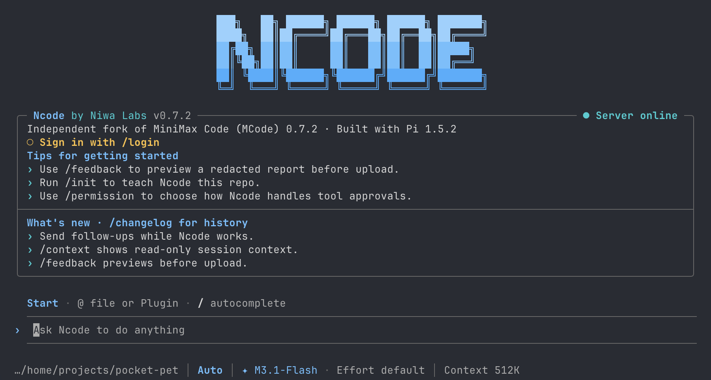

# Ncode · Niwa Labs

Ncode 是 Niwa Labs 独立维护的终端编程助手，基于 MiniMax Code（MCode）和 Pi 构建。你可以使用 MiniMax 模型，也可以连接自己的模型服务。

## Ncode 在 MCode 基础上增加了什么

- **每日自动签到。** 登录 MiniMax 后，在终端打开 `ncode` 就能领取当天可领的积分。签到确认后，当天再打开同一配置档会跳过签到。ACP 和无界面模式也会跳过自动签到。
- **关闭终端后任务仍可继续。** 终端、`ncode exec` 和 ACP 共用本地守护进程。回到同一工作区，使用相同的配置档运行 `ncode --continue` 即可继续对话。
- **子代理可以在后台工作。** 主代理等待子代理时，你可以发来新指令。主代理可以接着处理，子代理则在后台完成任务。守护进程重启后，Ncode 会检查哪些已完成的任务还需要通知主代理。
- **从对话到后台任务，都由 Pi 驱动。** MCode 已经使用 Pi 流式返回回复、执行工具，再把工具结果交给模型继续处理。Ncode 还用 Pi Durable 调度后台任务，并将会话历史写入压缩的 SQLite 数据库。重新打开会话时，消息和工具结果都还在。
- **在命令行切换账号。** 用 `ncode --profile work` 单独保存工作账号的登录信息、会话和设置。运行 `ncode profile list` 即可查看已有的配置档。

[会话与恢复机制](docs/architecture.md) · [账号配置档](docs/installation.md#profiles)

<p align="center">
  <a href="#快速开始">Get started</a> ·
  <a href="docs/README.md">Documentation</a> ·
  <a href="docs/examples.md">Examples</a> ·
  <a href="CONTRIBUTING.md">Contributing</a>
</p>
<p align="center"><a href="README.md">English</a> · <strong>简体中文</strong></p>
<p align="center">
  
  
  <a href="LICENSE-STATUS.md"></a>
</p>



## 快速开始

### 1. 安装 Ncode

```sh
npm install --global @niwa-labs/ncode
ncode --version
```

#### 从源码构建

在本分支的工作目录中使用受支持的 Node.js 和 pnpm 9.12.0。

```sh
node scripts/check-windows-source-location.mjs
pnpm install --frozen-lockfile
pnpm build
pnpm ncode --version
```

在工作目录中运行 `pnpm ncode`，或在其他目录中用 Node.js 运行构建后的
`dist/cli.js`。下文用 `ncode` 指代构建后的 CLI，现有集成仍可使用 `mcode`。MiniMax 官方安装器、软件包和更新渠道属于
[上游项目](https://github.com/MiniMax-AI/minimax-code)。要更新此分支，请切换到较新的源码版本并重新构建。

### 2. 登录账号或配置 API Key

中国大陆账号运行：

```bash
ncode login
```

Global 账号运行：

```bash
ncode login --region global
```

在浏览器中完成登录，再启动 `ncode`，通过 `/status` 检查账号、通过 `/provider` 选择模型。退出登录使用 `ncode logout`。

Token Plan 需要账号与可用额度。从本仓库构建的版本与已发布的 npm CLI `@minimax-ai/code@0.6.9` 均默认将用户数据保存在 `~/.minimax`（选择 profile 时为 `~/.minimax-<profile>`）。`MINIMAX_DATA_DIR` 或 `MAVIS_DATA_DIR` 可以覆盖数据目录。安装脚本使用的 `~/.minimax-code` 安装目录与数据目录的选择是两回事。查找或删除配置和会话前，请参阅[账号与数据](docs/installation.md#accounts-and-data)。

<details>
<summary>使用自己的 API Key（BYOK）</summary>

BYOK 无需先登录 MiniMax。先在当前 shell 中设置 `MCODE_PROVIDER_API_KEY`，再添加提供方；将下方示例地址和模型名替换为实际配置：

```bash
ncode provider add --name my-provider --base-url https://example.com/v1 \
  --api-format openai-completions --model my-model \
  --api-key-env MCODE_PROVIDER_API_KEY --use
ncode
```

`--use` 会先测试第一个模型，成功后保存并设为默认模型；连接测试失败时不保存。省略 `--use` 则仅保存，不测试，也不改变默认模型。对于自定义或本地模型，可添加 `--context-limit 32768 --output-limit 4096`（请填写服务器的实际限制）。两个值都必须是正安全整数，并应用于所有重复指定的 `--model`。可通过 `ncode provider list --json` 查看已配置的限制。省略这两个参数时保持现有的模型限制默认值。

支持 `openai-completions`、`openai-responses` 和 `anthropic-messages`。连接测试、单次模型切换及环境变量设置见 [模型示例](docs/examples.md#2-choose-your-own-model)。

通过该命令添加的提供方保存在当前 profile `config.yaml` 的 `custom_provider` 下；第三方或自建端点一律走这条路径，`minimax_api` 保留给官方 MiniMax API。若中转端点只提供 Anthropic 兼容接口且要求 `Authorization: Bearer` 鉴权，可在 `config.yaml` 中为提供方配置自定义 headers；见[第三方中转与自定义鉴权头](docs/examples.md#third-party-relays-and-custom-auth-headers)。

</details>

### 3. 做一个自己的桌面宠物

给一个会眨眼的小宠物加上番茄钟，再追问一句：“长按才能暂停，结束时跳舞。”看代码变成可以亲手操作的结果。

[](docs/demo.md)

<p align="center"><a href="docs/demo.md">看真实修改与浏览器演示 →</a> · <a href="examples/pocket-pet">自己做一次 →</a></p>

**无需硬件。** 示例在本地浏览器运行，不需要前端依赖。让 CLI 修改代码需要 MiniMax 账号及可用额度，或你自己的兼容模型 API；模型调用可能产生费用。完成版可直接运行，无需模型账号。

克隆仓库，把起始工程复制到独立目录：

```bash
node examples/pocket-pet/setup.mjs ../my-pocket-pet
cd ../my-pocket-pet
node serve.mjs
```

打开 `http://127.0.0.1:4173`。另开一个终端，在 `my-pocket-pet` 目录运行 `ncode`，依次粘贴[第一条提示词](examples/pocket-pet/README.md#first-request)和[追加需求](examples/pocket-pet/README.md#change-the-requirement)，每次修改后刷新浏览器。

想先体验成品？在仓库根目录运行 `node examples/pocket-pet/serve.mjs finished`，打开同一地址。加上 `?demo=1` 可体验有明确标识的 10 秒演示模式。

[完整教程与使用条件](examples/pocket-pet) · [小型代码修复示例](examples/clamp) · [模型、搜索与工具](docs/examples.md)


### 在自己的项目中使用

进入要处理的项目目录：

```bash
cd /path/to/your/project
ncode
```

在 TUI 中描述任务，也可以在启动时直接提交：

```bash
ncode "Find a failing test, fix the implementation, and run the relevant tests."
```

使用 `ncode init .` 生成或更新 `AGENTS.md` 项目指导。任务中应说明期望结果、修改边界和验证方式。

| 入口 | 命令 | 适用场景 |
| --- | --- | --- |
| 交互式 TUI | `ncode [prompt]` | 探索代码、持续对话、审阅修改与权限确认。 |
| Headless | `ncode exec [prompt]` | Shell、CI、批处理与评测。 |
| ACP | `ncode acp` | 支持 Agent Client Protocol 的编辑器与客户端。 |
| TypeScript SDK | [`@minimax-ai/code-sdk`](packages/code-sdk/README.md) | 在 Node.js 代码中驱动 `ncode exec`：启动、流式读取和续跑对话。 |

### 轻量对话

对于简单对话或通用知识问答，可用 `--mode lightweight` 创建新会话：

```bash
ncode --mode lightweight "解释 DNS 缓存的工作原理。"
ncode exec --mode lightweight "概述 CAP 定理。"
```

轻量模式只发送精简的对话系统提示词，不发送工具 schema，并从提供方上下文中省略工作区
指令、Skills、memory 块、MCP schema 和完整环境块，因此不能检查或修改本地文件。需要编程或工具能力时，请使用
`ncode --mode standard` 或 `ncode exec --mode standard` 创建新的标准会话；省略 `--mode`
与标准模式完全一致。

模式在根会话创建时固定，因此 `--mode lightweight` 不能与 `--session` 或 `--continue`
同时使用。子代理/子会话不会继承轻量模式，`/compact` 仍使用标准压缩上下文，ACP 与桌面端
会话也始终使用标准模式。重新打开轻量会话时会保留该模式，并在 TUI 状态栏显示
`Lightweight`；从轻量模式启动的 TUI 打开标准会话时仍保持标准模式，且不显示该标记。

### 继续之前的工作

终端、Headless CLI 和 ACP 共用所选 profile 的本地守护进程。参见[守护进程命令](docs/installation.md#local-daemon)。

```bash
# 恢复当前工作区最近的会话
ncode --continue

# 打开会话选择器
ncode --session
```

在 TUI 中输入 `/sessions` 查找历史会话，输入 `/help` 查看完整命令与快捷键。

| 操作 | 快捷键 |
| --- | --- |
| 发送消息，或在任务运行中调整当前响应 | `Enter` |
| 在任务运行中将后续消息加入队列 | `Alt+Enter` |
| 在输入框中换行 | `Shift+Enter` |
| 引用工作区文件或目录 | `@` |
| 切换 Plan Mode | `Shift+Tab` |
| 切换权限模式 | `Alt+M` |
| 关闭面板或中断正在运行的任务；在模型回复之前中断会把消息放回输入框 | `Esc` |

## 卸载

卸载前请关闭正在运行的 MCode 会话，包括编辑器中的集成。先通过 `command -v mcode`（macOS / Linux / WSL）或 `Get-Command mcode -All`（PowerShell）定位命令，再按对应的安装方式操作。当前官方安装脚本**不提供卸载参数**。

### 通过脚本安装

以下命令会删除默认安装目录，包括两个启动器、下载的版本，以及安装器管理的 Node.js 运行时。如果使用过 `MCODE_INSTALL_DIR`，请替换为实际安装目录。删除前请先检查：早期源码构建曾将用户数据保存在 `~/.minimax-code`，自定义数据目录也可能与安装目录重合。请先备份需要保留的配置和会话。

**macOS / Linux / WSL**

```bash
rm -rf -- "$HOME/.minimax-code"
```

从安装器修改的 shell 配置文件中删除 `# MiniMax Code CLI` 注释及其下一行 PATH 配置：zsh 使用 `~/.zshrc`；bash 依次选择 `~/.bashrc`、`~/.bash_profile`、`~/.profile` 中第一个已存在的文件，均不存在时创建 `~/.bashrc`；fish 使用 `~/.config/fish/config.fish`；其他 shell 使用 `~/.profile`。对应配置为 `export PATH="/absolute/install/path/bin:$PATH"`，fish 则为 `fish_add_path -g "/absolute/install/path/bin"`。只移除 MCode 对应的条目，保留其他 PATH 设置。如果设置了 `MCODE_NO_MODIFY_PATH` 或路径已存在，安装器会跳过此修改。

**Windows（PowerShell）**

```powershell
Remove-Item -LiteralPath "$env:USERPROFILE\.minimax-code" -Recurse -Force
```

打开“编辑账户的环境变量”，编辑用户 **Path**，仅删除安装目录对应的条目（默认为 `%USERPROFILE%\.minimax-code`，也可能显示为展开后的绝对路径）。Windows 安装器修改的是用户 Path，不是 PowerShell 配置文件；设置 `MCODE_NO_MODIFY_PATH` 会跳过此持久化修改。

### 通过 npm 或源码安装

全局 npm 安装请使用当初安装 MCode 时的同一套 npm 和安装前缀：

```bash
npm uninstall -g @minimax-ai/code
```

源码构建请先保存工作，再仅删除自己创建的源码目录，详见[更新或移除](docs/installation.md#update-or-remove)。

卸载后重新打开终端（编辑器集成终端需要完全重启编辑器），再次运行 `command -v mcode` 或 `Get-Command mcode -All`。没有结果表示 PATH 中已找不到该命令。如果出现另一份安装，请先确认它的安装方式再移除。

### 可选：删除用户数据

移除程序会保留单独存储的用户数据。如果还要删除本地登录状态、提供方配置、缓存和会话，请先按[账号与数据](docs/installation.md#accounts-and-data)确认实际数据目录，并备份需要保留的内容。其他 MCode 安装可能共用该目录。以下命令仅适用于默认的 `~/.minimax`：

```bash
# macOS / Linux / WSL — 永久删除默认用户数据
rm -rf -- "$HOME/.minimax"
```

```powershell
# Windows — 永久删除默认用户数据
Remove-Item -LiteralPath "$env:USERPROFILE\.minimax" -Recurse -Force
```

profile 使用 `~/.minimax-<profile>`；`MINIMAX_DATA_DIR` 或 `MAVIS_DATA_DIR` 可以指定其他位置。只删除确定不再需要的具体目录，不要使用通配符批量删除。如果不再需要自行添加的 MCode 环境变量，也请从 shell 配置或用户环境变量设置中移除对应赋值。

## 可以做什么

| 场景 | 使用方式 |
| --- | --- |
| **修改与验证代码** | 读取文件、编辑 diff、执行 Shell 和测试；通过权限与沙箱控制工具执行。 |
| **选择模型** | MiniMax 账号 / Token Plan，或兼容 OpenAI、Anthropic 格式的自定义提供方。 |
| **搜索与多模态** | 内置搜索、`mcode-tools` 媒体工具、MCP 和托管连接器；按账号权限和服务额度使用。 |
| **延续工作** | 会话恢复、任务规划、子 Agent、官方 / 本地 / GitHub 插件与内置 Skills。 |
| **接入工作流** | Headless CLI 用于脚本任务，ACP 用于兼容的编辑器和客户端。 |

账号、更新、反馈与诊断能力也在。托管工具需要网络和相应授权，详细边界见 [能力与服务边界](docs/tui-capabilities.md)。


## 从源码构建

开发 Ncode 或运行本仓库源码需要 Git、Node.js **22.19+（22 系列）、24.2+（24 系列）、25 或 26**，以及 **pnpm 9.12.0**。在 Windows 上，请将源码放在本地 NTFS 卷上，并避开云同步目录；下面的预检命令会在 pnpm 创建 workspace link 前检查卷类型。
```bash
node scripts/check-windows-source-location.mjs
pnpm install --frozen-lockfile
pnpm build
pnpm ncode
```

首次构建需要联网；依赖和经过校验的 `mcode-tools` 均来自公共 npm。pnpm 安装、系统依赖和更新方法见[源码安装指南](docs/installation.md)。

从源码目录运行时，将上方示例中的 `ncode` 替换为 `pnpm ncode`。要在自己的项目中工作，先切换到项目目录，再运行构建产物：

```bash
node /absolute/path/to/minimax-code/dist/cli.js
```

本仓库构建 **Niwa Labs Ncode 0.7.2**。上游基线和内置工具版本见[源码状态](docs/open-source-status.md#version-and-evidence-baseline)。

## 文档与贡献

- [安装与账号配置档](docs/installation.md)
- [架构](docs/architecture.md)
- [贡献指南](CONTRIBUTING.md)、[安全报告](SECURITY.md)和[第三方声明](THIRD_PARTY_NOTICES.md)

如需反馈分支问题，请使用 Niwa Labs 分支的 Issues。MiniMax 账号、官方安装器和桌面应用请参阅
[上游 MiniMax Code](https://github.com/MiniMax-AI/minimax-code)。

## 许可

第一方代码默认采用 [MIT](LICENSE)；文件或子包已有独立声明时保留原许可。依赖、资源与 `mcode-tools` 的许可分别见 [第三方声明](THIRD_PARTY_NOTICES.md) 和 [许可状态](LICENSE-STATUS.md)。
