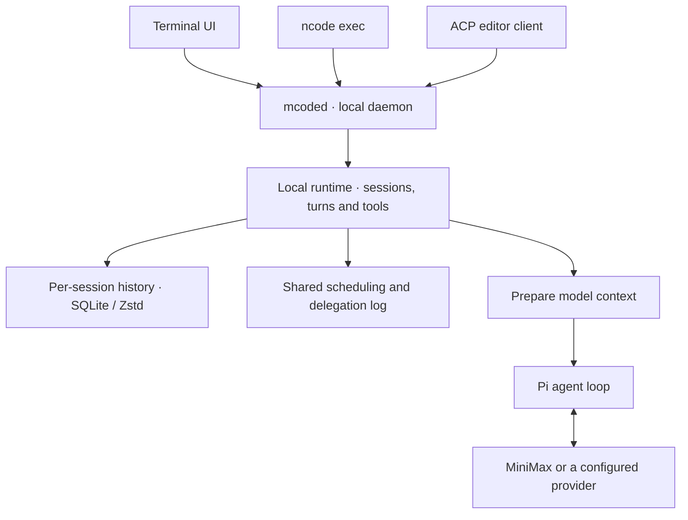

# Ncode architecture

When you open `ncode`, the terminal connects to a local daemon for your profile. The daemon runs the agent, so you can close the terminal while a task is working. `ncode exec` and ACP editors use the same runtime. Daily MiniMax check-in belongs to the interactive terminal's startup.

For an in-process session, set `MCODE_SERVER_MODE=off`. On the welcome screen, **Server online** means the terminal is connected to its local daemon. [Daemon commands](installation.md#local-daemon)

## What happens to my prompt?

The runtime starts a turn. Pi's provider adapter streams the reply, and its agent loop calls tools and feeds their results into the next model request. The host checks tool permissions and sends approval requests back to the client. If the agent is busy, you can steer the current turn or queue a message for the next one. Ncode records when it accepts your input and when that input reaches the model context. [Turn system](../packages/local-runtime-v2/src/service/turn-system) · [Input delivery](../packages/input-delivery)

When the parent agent is waiting for a subagent, a new instruction can release that wait. The child keeps running in the background, and the parent can answer you right away. When the child finishes, its result goes back to the parent session. [Subagent recovery scenarios](../packages/local-runtime-v2/test/integration/reactive-task-batch-recovery.e2e.test.ts)

## What can an ACP editor see?

Start the adapter with `ncode acp`. Its `initialize` response lists supported extensions under `_meta["minimax-code/extensions"].methods`. Standard ACP session loading and resuming still work. An editor that supports Ncode’s `session/history` extension can open a transcript without taking over a running session or sending a prompt. The first page contains the most recent entries. Follow `nextCursor` for older pages. Tool calls and their results have matching IDs, so the editor can show the command beside its output. Compaction summaries are marked as such. [History contract and paging tests](../packages/tui/test/unit/acp-session-history.test.ts)

After reconnecting, a client can call `mcode/session/turn_status` for the active turn, latest recorded activity and queue depth. It can queue a follow-up for a session opened by another client. The `mcode/` prefix is part of the protocol. [ACP extensions](../packages/tui/src/acp/extensions.ts)

A harness that supplies its own tools starts the adapter with `ncode acp --no-builtin-tools` (or sets `MCODE_NO_BUILTIN_TOOLS=1` for the process). Every built-in tool, the bundled Matrix MCP server, thread-goal tools and the codemode runtime are then dropped from every turn's toolset, and only the MCP servers configured for the session or the data dir remain — the model sees exactly the tools the harness passes in `session/new`. The filtering sits at the tool-source level rather than per tool name, so built-ins added by later versions stay covered. The flag hosts the runtime in the adapter process (`--no-daemon` semantics), because a shared daemon started without the variable would not honor the request. `ncode exec --no-builtin-tools` applies the same mode to a one-shot run.

## How does a long conversation fit?

Each session has its own SQLite history store with Zstd compression. For each model call, the runtime selects the messages it needs from that history. It can reuse previously converted messages and use placeholders for images outside the media budget. In the default durable mode, Ncode starts preparing a summary in the background at 50% of the model window. At the blocking threshold (75% by default, capped to leave the model its reserve), the next call can join that job. Messages that arrived while the summary was being written stay in the recent tail. Earlier turns remain in the transcript. [Session storage](../packages/local-runtime-v2/src/service/session-system/messages/history/durable-session-stores.ts) · [Model context](../packages/local-runtime-v2/src/service/turn-system/compaction/context-wire.ts)

## What happens when I come back?

Run `ncode --continue` in the same workspace and profile to reopen the latest conversation, or `ncode --session` to choose one. A reconnecting client can ask for events after the last one it saw. If that event is too old for replay, the daemon reports the gap. The saved conversation is still available. [Event replay](../packages/mcoded/src/hub.ts)

Ncode uses Pi Durable’s commit and watch APIs with its own SQLite/Zstd backend. Alongside each session’s conversation, the daemon keeps a shared log for scheduling and delegation. Pi Durable schedules those tasks. The storage adapter uses Chord to apply a document’s saved changes when reading its current state. If a background task finished just before the daemon stopped, startup recovery checks for a saved result whose notification is still due and schedules it for delivery to the parent session. [Orchestration](../packages/local-runtime-v2/src/service/orchestration/runtime-orchestration.ts) · [Startup recovery](../packages/local-runtime-v2/src/runtime.ts)

## Where to look in the source

The CLI entry points live in `packages/tui`, the daemon in `packages/mcoded`, and the session runtime in `packages/local-runtime-v2`. It shares permissions and sandboxing with `packages/local-runtime`. Pi, Pi Durable and Chord are bundled under `third_party/`. [Dependency notices](../THIRD_PARTY_NOTICES.md) · [Verification](verification.md)
