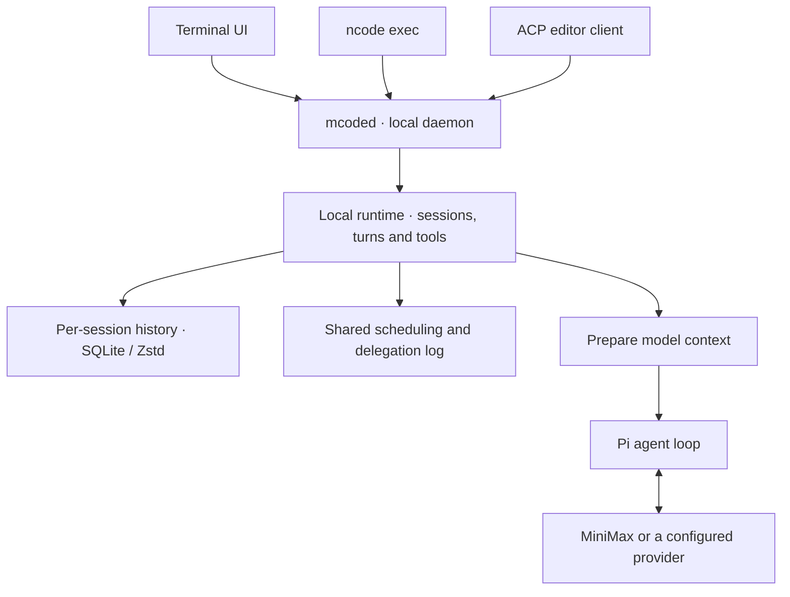

# Ncode architecture

Ncode keeps a coding session on the local machine. The terminal UI, headless CLI and ACP editor clients all connect to the runtime for the selected profile. Each client can disconnect while the daemon continues running. MiniMax sign-in and custom provider settings belong to that profile.

Set `MCODE_SERVER_MODE=off` to run the runtime inside the client process. The diagram shows the default daemon mode.

## From prompt to reply

1. **Connect.** The CLI resolves the profile's data directory and starts or reuses its daemon. The daemon accepts local connections, acknowledges submitted messages and streams turn events back to attached clients. In the welcome screen, **Server online** means the terminal has connected to the local daemon. [Daemon implementation](../packages/mcoded/src/hub.ts) · [Daemon commands and in-process mode](installation.md#local-daemon)
2. **Run a turn.** The runtime decides whether input starts a turn, steers the active turn or waits in the session queue. Pi runs the model and tool loop. The host supplies tool implementations, enforces permissions and sends approval requests back to the client. A background task can finish after the client disconnects. [Turn system](../packages/local-runtime-v2/src/service/turn-system) · [Pi runner](../packages/agent-core/src/pi-turn-runner) · [Permission routing](../packages/mcoded/src/permission-router.ts)
3. **Prepare the next model request.** The context pipeline selects a window from committed history, converts entries to the provider's message format and reuses compiled segments. It can substitute placeholders for images outside the media budget. Compaction records a summary checkpoint so later turns can use it with recent messages. [Request preparation](../packages/local-runtime-v2/src/service/turn-system/compaction/context-wire.ts) · [Compaction](../packages/local-runtime-v2/src/service/turn-system/compaction/product-unified-compaction.ts)

## What survives a restart

| State | Where it lives and how it is used |
| --- | --- |
| Conversation history | Each session has its own SQLite store with Zstd-compressed data under `durable-history/sessions/` in the profile's data directory. The runtime can seed a session from the older shared history store on its first write. `MCODE_HISTORY_PROVIDER=jsonl` selects the compatibility backend. [Session storage](../packages/local-runtime-v2/src/service/session-system/messages/history/durable-session-stores.ts) |
| Work shared across sessions | The daemon owns the system log for scheduling and delegation. On startup the runtime reconciles released subagent tasks with the parent's history and reschedules eligible completion notifications left undelivered by a previous owner. [Orchestration](../packages/local-runtime-v2/src/service/orchestration/runtime-orchestration.ts) · [Startup recovery](../packages/local-runtime-v2/src/runtime.ts) |
| Client event position | Events have sequence numbers. A reconnecting client can request events after its last cursor. When that position falls outside the retained window, the daemon reports `replay_gap`. The session's saved history remains available when the conversation is reopened. [Event replay](../packages/mcoded/src/hub.ts) |

To reopen the most recent session, run `ncode --continue` in the same workspace and profile. Use `ncode --session` to choose another session. [Profiles and data directories](installation.md#accounts-and-data)

## Source map

Terminal, headless and ACP entry points live in `packages/tui`. The daemon lives in `packages/mcoded`. The runtime is assembled in `packages/local-runtime-v2` and uses `packages/local-runtime` for shared host facilities, including permissions and sandboxing. Pi, Pi Durable and Chord are vendored under `third_party/`. [Dependency notices](../THIRD_PARTY_NOTICES.md)

The internal `@mavis/*` packages resolve to workspace sources. `release/public-source.json` lists the exported files. `pnpm check:source` checks this inventory and `pnpm check:standalone` checks the build graph. [Verification](verification.md)
