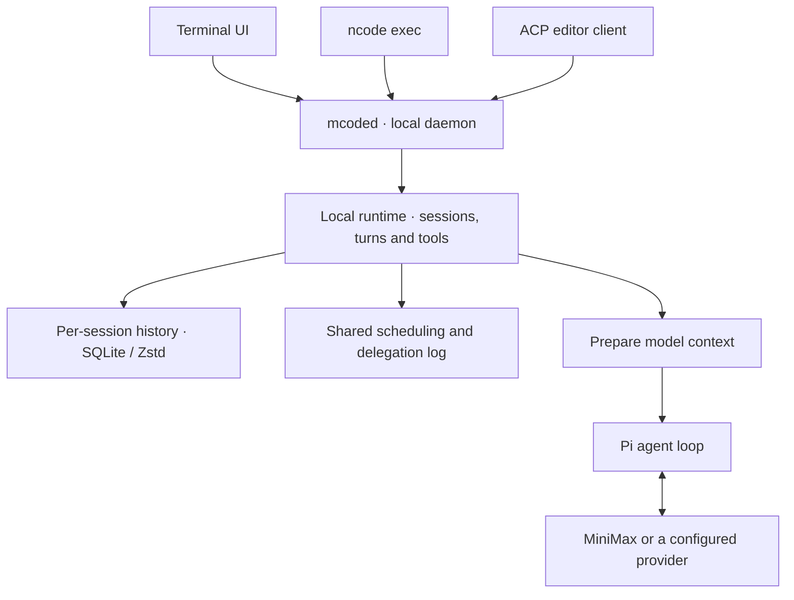

# Ncode architecture

When you open `ncode`, the terminal connects to a local daemon for your profile. The daemon runs the agent, so you can close the terminal while a task is working. `ncode exec` and ACP editors use the same runtime. Daily MiniMax check-in belongs to the interactive terminal's startup.

For an in-process session, set `MCODE_SERVER_MODE=off`. On the welcome screen, **Server online** means the terminal is connected to its local daemon. [Daemon commands](installation.md#local-daemon)

## What happens to my prompt?

The runtime starts a turn and Pi runs the model and tool loop. The host checks tool permissions and sends approval requests back to the client. If the agent is busy, you can steer the current turn or queue a message for the next one. Ncode records when it accepts your input and when that input reaches the model context. [Turn system](../packages/local-runtime-v2/src/service/turn-system) · [Input delivery](../packages/input-delivery)

## How does a long conversation fit?

Each session has its own SQLite history store with Zstd compression. For each model call, the runtime selects the messages it needs from that history. It can reuse previously converted messages and use placeholders for images outside the media budget. As the conversation grows, compaction saves a summary alongside the history. Later requests can use the summary and recent messages together. [Session storage](../packages/local-runtime-v2/src/service/session-system/messages/history/durable-session-stores.ts) · [Model context](../packages/local-runtime-v2/src/service/turn-system/compaction/context-wire.ts)

## What happens when I come back?

Run `ncode --continue` in the same workspace and profile to reopen the latest conversation, or `ncode --session` to choose one. A reconnecting client can ask for events after the last one it saw. If that event is too old for replay, the daemon reports the gap. The saved conversation is still available. [Event replay](../packages/mcoded/src/hub.ts)

The daemon also keeps a shared log for scheduling and delegation. If a background task finished just before the daemon stopped, startup recovery checks for a saved result whose notification is still due and schedules it for delivery to the parent session. [Orchestration](../packages/local-runtime-v2/src/service/orchestration/runtime-orchestration.ts) · [Startup recovery](../packages/local-runtime-v2/src/runtime.ts)

## Where to look in the source

The CLI entry points live in `packages/tui`, the daemon in `packages/mcoded`, and the session runtime in `packages/local-runtime-v2`. It shares permissions and sandboxing with `packages/local-runtime`. Pi, Pi Durable and Chord are bundled under `third_party/`. [Dependency notices](../THIRD_PARTY_NOTICES.md) · [Verification](verification.md)
